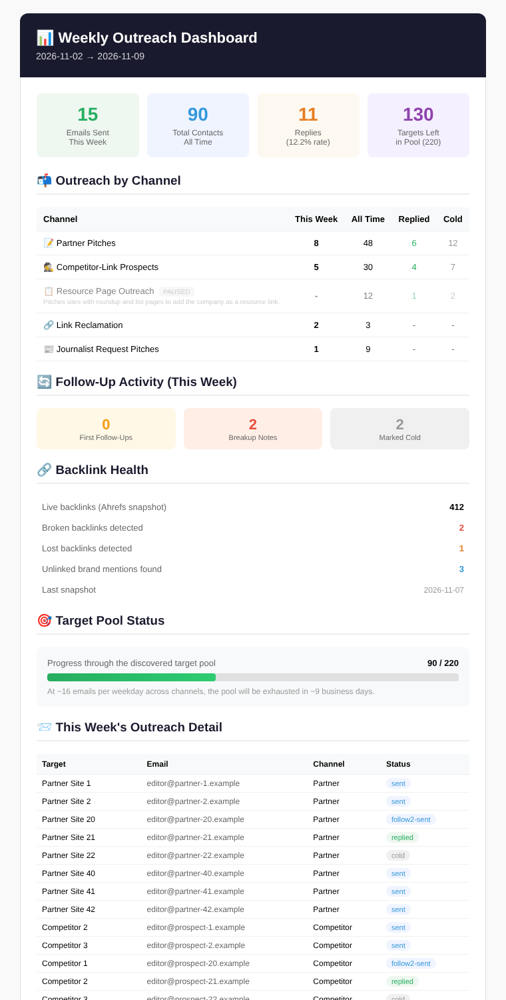
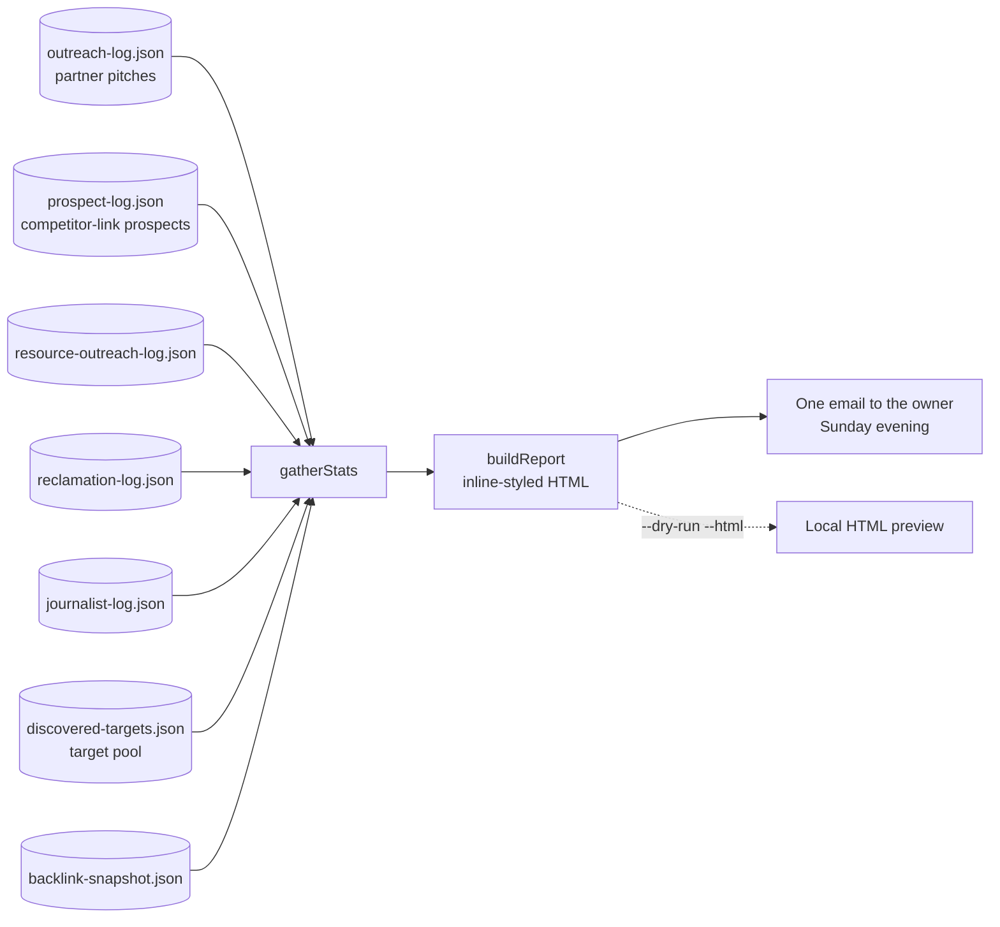

# Outreach Funnel Dashboard: one weekly email that shows every outreach channel and how long the target pool will last

A Sunday-evening job that reads the JSON logs written by each outreach automation and sends a single report: emails sent, replies, reply rate, follow-up activity, link health, and how many business days of targets are left before the pool runs dry.



*Rendered from generated sample data (`npm run sample`).*

## The problem

Each outreach automation sent its own run summary. That meant several emails a day, none of which answered the questions that mattered on Monday morning:

- How many emails went out last week, across everything?
- What is the reply rate, overall and by channel?
- Are follow-ups actually going out?
- When do we run out of people to contact?

The last question matters because the senders work through a finite pool of discovered targets, and no per-run summary said how much of it was left.

## What it does

`src/dashboard.js` runs once a week and builds one HTML email from the logs:

| Section | Source | What it shows |
|---|---|---|
| Top-line tiles | All outreach logs | Emails this week, total contacts, replies with reply rate, targets left |
| Outreach by channel | One log per channel | This week, all time, replied and cold, per channel. Paused channels are greyed out, not hidden |
| Follow-up activity | Status fields in the outreach logs | First follow-ups, breakup notes and contacts marked cold this week |
| Link health | Snapshot and reclamation logs | Live links, broken, lost and unlinked mentions |
| Target pool | Discovered-targets file vs. contacted | Progress bar and business days of runway at the current send rate, with a warning under 50 |
| This week's detail | Outreach logs | Up to 30 rows: target, address, channel, status |

## Architecture



## Key design decisions

**Read-only by design.** The dashboard never writes to a log. It can run at any time, alongside any sender, without the risk of corrupting state.

**A missing log is an empty channel.** Every file load is wrapped. A channel that has not run yet, or has been retired, shows zeros and the rest of the report still sends.

**Runway is a first-class number.** The report divides the remaining pool by the combined weekday send rate and prints the result in business days, with a red warning when fewer than 50 targets remain. No individual sender could report this, because the pool is shared.

**Paused is visible.** A paused channel stays in the table, greyed out with a label and a one-line description, so nobody wonders months later why it has no numbers.

**The subject line carries the headline.** Sent count and reply count are in the subject, so the week's result is readable from the inbox list without opening the email.

**One report replaces many.** The per-run summaries from individual senders stay available for debugging, but this is the only one meant to be read every week.

**Previewable offline.** `--dry-run --html=out.html` writes the exact report HTML to disk. `npm run sample` generates example logs and renders the report with no credentials.

## Repository layout

```
src/dashboard.js              log loading, stats, HTML report, email
scripts/make-sample-data.js   generated example logs for an offline preview
docs/sample-report.png        the report rendered from sample data
.github/workflows/            Sunday run, reads the outreach state from the Actions cache
```

## Setup

Requires Node 20+ and a mailbox with an app password for sending.

```bash
npm install
npm run sample                 # writes sample-report.html from generated data
cp .env.example .env           # fill in values
npm run dry-run                # totals from your real logs, nothing sent
npm run report
```

| Variable | Purpose |
|---|---|
| `GMAIL_USER`, `GMAIL_APP_PASSWORD`, `EMAIL_NOTIFY` | Sending the report |
| `COMPANY_NAME` | Used in the subject and footer |
| `DAILY_SEND_RATE` | Combined emails per weekday across channels, for the runway estimate. Default 16 |
| `STATE_DIR` | Folder holding the sender scripts' JSON logs. Default `./state` |

The logs come from the sender jobs: [partner-prospecting](https://github.com/Michael-Wootan/partner-prospecting), [competitor-link-prospecting](https://github.com/Michael-Wootan/competitor-link-prospecting), [journalist-request-monitor](https://github.com/Michael-Wootan/journalist-request-monitor) and [link-reclamation](https://github.com/Michael-Wootan/link-reclamation). Follow-up statuses are written by [followup-sequencer](https://github.com/Michael-Wootan/followup-sequencer).

Scheduled runs are off by default. Set the repository variable `ENABLE_SCHEDULE` to `true` to turn the schedule on; manual runs from the Actions tab always work.

---

Extracted from a production automation suite I built and ran for a live e-commerce and B2B wholesale business, 2026.

© Michael Wootan. Source shared for portfolio review; all rights reserved.
